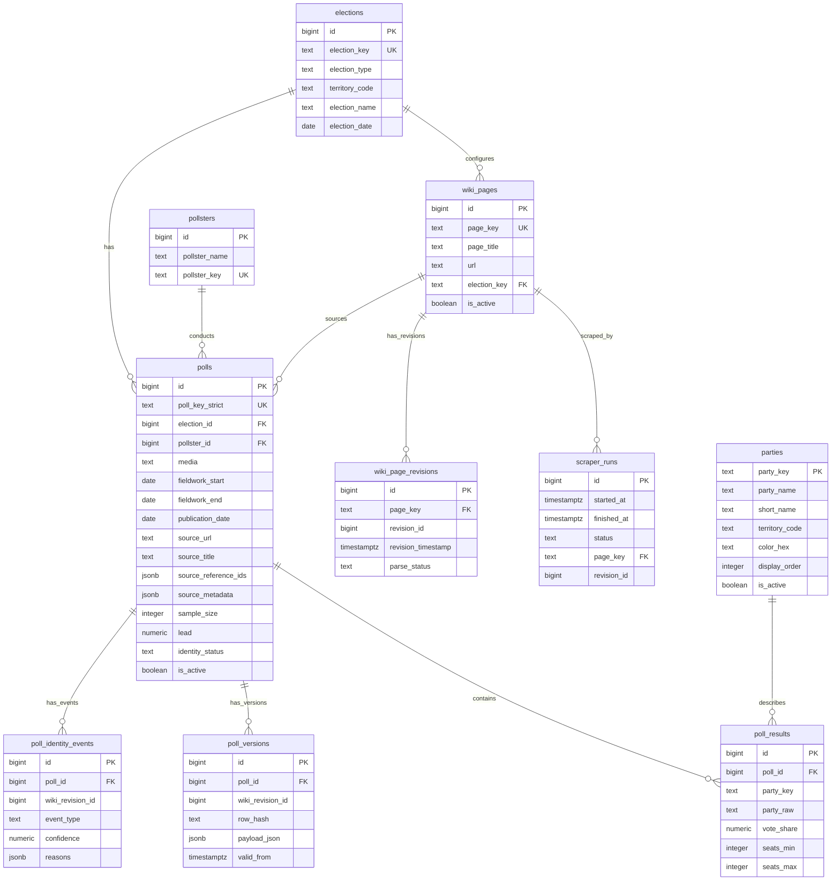

# Entity Relationship

## Explicacion textual

`elections` define las elecciones disponibles. Cada `wiki_pages` pertenece a una eleccion mediante `election_key` y representa una pagina Wikipedia configurada para scraping.

`polls` es la entidad central. Cada encuesta pertenece a una `elections` por `election_id`, a una `pollsters` por `pollster_id`, y a una pagina fuente por `wiki_page`. Sus resultados se almacenan en `poll_results`, una fila por partido. `parties` cataloga nombres, colores y orden de visualizacion para claves de partido conocidas.

`wiki_page_revisions` conserva snapshots de revisiones Wikipedia y permite saber si una revision ya fue procesada correctamente. `poll_versions` conserva payloads historicos de encuestas cuando cambian. `poll_identity_events` registra decisiones de matching, correcciones, ambiguedades y desactivaciones. `scraper_runs` audita cada ejecucion.

Algunas relaciones son logicas pero no estan reforzadas por FK: `wiki_revision_id` y `revision_id` son IDs de MediaWiki, no claves primarias de `wiki_page_revisions`.

## Diagrama Mermaid ER

